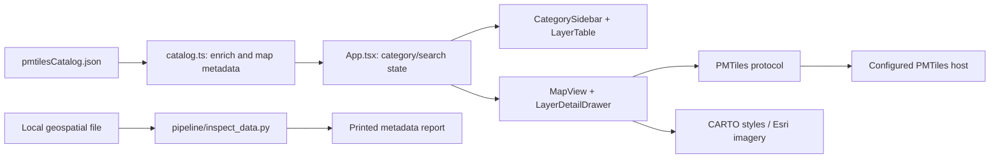

# Layerloom Technical Documentation

## 1. Project status

**Layerloom is an implemented frontend prototype, not a complete production-ready
geospatial data platform.** It has a React application, a 49-record layer
catalogue, a MapLibre map view that reads PMTiles, and a Python utility for
inspecting geospatial files. The frontend has a reproducible TypeScript/Vite
production build and a CI build workflow. It does not yet include a spatial
data-processing pipeline, server-side geographic filters, generated
GeoParquet/GeoJSON files, or a production deployment.

## 2. Purpose and scope

Layerloom is a browser-based catalogue and map preview for Indian geospatial
datasets. Users can browse datasets by domain, search catalogue metadata, open
a map preview, combine visible layers, adjust opacity, switch basemaps, search
features currently rendered on the map, click to inspect feature properties,
and open the hosted PMTiles source.

The current architecture is intentionally static: there is no application
backend, spatial database, user authentication, or server-side analysis.
Geospatial data preparation and hosting are separate from the React
application.

## 3. Repository structure

```text
.
├── data/
│   ├── raw/                  # Placeholder for source datasets
│   ├── processed/            # Placeholder for prepared datasets
│   └── tiles/                # Placeholder for generated tiles
├── docs/
│   ├── ARCHITECTURE.md       # Existing introductory architecture guide
│   ├── PRD.md                # Product requirements and planned MVP
│   ├── TASKS.md              # Existing implementation roadmap
│   ├── TECHNICAL_DOCUMENTATION.md
│   └── ENHANCEMENTS_ROADMAP.md
├── frontend/
│   ├── src/
│   │   ├── components/
│   │   │   ├── catalog/      # Category sidebar and layer table
│   │   │   ├── common/       # Application header and catalogue search
│   │   │   └── map/          # Map view and layer details drawer
│   │   ├── services/         # Static layer catalogue and metadata
│   │   ├── types/            # TypeScript layer/category definitions
│   │   ├── App.tsx           # View state, filtering, and page composition
│   │   └── main.tsx          # React entry point
│   ├── package.json          # Frontend dependencies and scripts
│   └── vite.config.ts        # Vite configuration and dev-only PMTiles middleware
├── pipeline/
│   ├── inspect_data.py       # Read-only geospatial file inspection utility
│   └── install_node.py       # Optional Node.js installer utility
└── requirements.txt          # Python geospatial/data dependencies
```

`frontend/node_modules`, build output, the Python virtual environment, and
large geospatial data files are not source modules. Data directories currently
contain placeholders rather than a checked-in processing pipeline or datasets.

## 4. Frameworks and libraries

| Area | Technology | Role in the current project |
| --- | --- | --- |
| UI | React 19 | Component-based catalogue and map interface |
| Language | TypeScript | Types for the application and layer catalogue |
| Build/dev server | Vite 6 | Frontend development server and production bundler |
| Map renderer | MapLibre GL JS | WebGL map rendering and basemap display |
| Vector tile access | PMTiles JS | MapLibre protocol for reading PMTiles sources |
| Styling | Tailwind CSS | Utility classes used by the React components |
| UI icons | lucide-react | Icons in catalogue, controls, and layer details |
| Geospatial inspection | GeoPandas | Reads supported vector/Parquet files in the Python utility |
| Python environment | Python 3.12 virtual environment is described in README | Local environment only; not a web service |

`requirements.txt` also declares PyArrow, DuckDB, Shapely, Fiona, PyProj,
Requests, Pandas, OpenPyXL, and tqdm. The tracked pipeline currently uses
GeoPandas; the other packages are not wired into a tracked processing workflow.

## 5. Application architecture and data flow



The browser loads the static JSON catalogue at build time through a TypeScript
import. `catalog.ts` augments records with selected hand-authored descriptions,
attributions, vintages, feature-count labels, and geometry types. It constructs
PMTiles URLs only; non-PMTiles exports are not presented as available
downloads. The default PMTiles base
URL is a Hugging Face dataset URL; `VITE_PMTILES_BASE_URL` can override it at
build time.

The map uses CARTO's Dark Matter and Positron style URLs or a custom Esri World
Imagery raster style. It can render several selected vector tile sources at
once and re-adds them after a basemap style change. A source-layer name comes
from the catalogue record; geometry type chooses circle, line, or fill
rendering. Clicked features are highlighted when the tile feature has an ID,
and their attributes appear in a scrollable inspection panel.

The Vite configuration contains a **development-server-only** middleware route
for `/pmtiles/` that serves files from a local `PMTiles` directory with byte
range responses and permissive CORS. This is not a production hosting service,
and the local tile directory is not checked into the repository.

## 6. Main application algorithms

### 6.1 Catalogue creation

1. Import records from `frontend/src/services/pmtilesCatalog.json`.
2. Look up selected records in an enrichment map keyed by dataset ID.
3. Use a keyword heuristic on the dataset ID to infer point or line geometry
   when no explicit enrichment exists; otherwise default to multipolygon.
4. Add a hosted PMTiles URL; no download URLs are generated for unsupported formats.
5. Count records in each of the six configured categories.

The keyword inference and fallback metadata are convenient for a prototype;
they are not a substitute for validating each dataset's actual schema,
geometry, source, licence, and update date.

### 6.2 Catalogue filtering

`App.tsx` retains the active view, selected category, search query, and selected
layer in React state. A memoized filter keeps records whose category matches
the selection and whose name, description, attribution, or category contains
the case-insensitive query. The map also searches matching attributes among
features currently rendered in the viewport and zooms to a match; this is not a
complete geographic index or an administrative-boundary filter.

### 6.3 Map initialization and layer rendering

`MapView` initializes a MapLibre map at the configured India center and zoom,
registers the PMTiles protocol, and adds active vector sources after the map
style loads. The layer manager toggles overlays and adjusts their opacity.
Switching basemaps replaces the map style and re-adds visible layers after the
style reloads. Click inspection uses feature state for tile features with IDs.
Map controls provide zoom in, zoom out, and a reset-to-India action.

### 6.4 Local dataset inspection

`pipeline/inspect_data.py` accepts a file path, uses GeoPandas to read Parquet
or another supported vector file, and prints file size, row count, geometry
types, CRS, bounds, non-geometry columns, and a three-row preview. It reports
whether the CRS is EPSG:4326; it does not reproject, validate, clean, convert,
or publish the input.

## 7. Implemented behavior and known limits

| Capability | Current implementation |
| --- | --- |
| Browse datasets by category | Implemented using the static catalogue |
| Search | Catalogue text search and search among features currently rendered in the map viewport |
| Map preview | Multiple PMTiles overlays with Dark, Light, and Satellite basemaps |
| Feature inspection | Click-to-select attributes; highlight depends on vector-tile feature IDs |
| Layer management | Toggle multiple layers, set opacity, and view a style-based legend |
| Downloads | Hosted PMTiles source link; other formats are clearly marked unavailable |
| Python data workflow | Inspection utility only; no automated ETL or tile generation |
| Persistence/backend | No application API, database, accounts, or server-side analysis |
| Build/deployment | Production build passes; CI runs a clean npm install and build. Production deployment is not configured |

The project requirement and architecture files describe intended capabilities
that exceed the implementation. Treat those documents as plans, not proof that
the listed features are working.

## 8. Running and validating locally

From `frontend`, install the Node dependencies and start the Vite development
server:

```powershell
npm install
npm run dev
```

The Vite configuration uses port `3000`. To inspect a local geospatial file
from the repository root:

```powershell
.\Web_GIS\Scripts\python.exe pipeline\inspect_data.py data\raw\your-file.geojson
```

The Python command assumes the documented virtual environment exists and has
the requirements installed. From `frontend`, `npm ci` installs the locked
dependencies and `npm run build` runs the TypeScript check and Vite production
build. A GitHub Actions workflow runs those same frontend checks on pushes and
pull requests. There is no test script in `frontend/package.json`.
